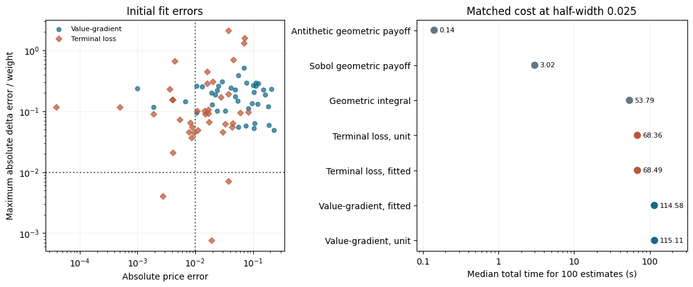

# Deep BSDE Pricing and Basket Greeks

A controlled study of European calls under correlated geometric Brownian motion.
Two neural formulations learn either a differentiable value function or the
Brownian control in the discounted BSDE. The study asks whether the fitted
models recover spot Greeks and whether their frozen controls make Monte Carlo
pricing cheaper at the same precision.

[Research report](docs/report.md) · [Executed research notebook](notebooks/deep_bsde_study.ipynb) ·
[Experiment design](experiments/design.json) · [Result data](experiments/results.json)

Point errors across all 78 fits and total time for 100 matched estimates.

## Results

The locked suite completed **78 fits** over three seeds and ten synthetic
contracts, including arithmetic baskets from 10 to 100 assets. Black–Scholes
and a geometric basket formula supply exact benchmarks. The eight arithmetic
references use independently checked randomized Sobol estimates.

| Solver | Price passes | All-coordinate delta passes | Joint passes |
| --- | ---: | ---: | ---: |
| Value-gradient | 3 / 39 | 0 / 39 | 0 / 39 |
| Terminal loss | 14 / 39 | 3 / 39 | 1 / 39 |

Both absolute tolerances are 0.01, in price units and in delta divided by the
asset weight. The joint pass was a vanilla terminal-loss fit. Six of the 24
ten-asset grid fits passed on price and all 24 missed the joint target.

On the ten-asset call at a 0.025 confidence-interval half-width, the median
cost of 100 estimates was **0.14 s** with an antithetic geometric-payoff
control and **68.36 s** with the cheapest learned variant. This includes
training, setup and coefficient fitting where applicable. Both conventional
controls qualified in all three seed cohorts at 0.01. Every learned variant
missed that tighter target.

The findings concern these contracts, architectures and training budgets.
Higher dimensions in the equal-weight ladder also change diversification.
The cost comparison assumes repeated estimation of one fixed contract.

## Reproduce

Run from the repository root.

~~~sh
conda env create -f environment.yml
conda activate bsde-pricing
python -m unittest discover -s tests
~~~

The notebook runs on the retained Apple silicon result data and recomputes
small Black–Scholes, finite-difference and martingale diagnostics. It can be
run from the repository root or the `notebooks/` directory.

~~~sh
python -m bsde_pricing experiment-design
python -m bsde_pricing final-suite --run-dir scratch/runs/final_suite
python -m experiments.summarize scratch/runs/final_suite/report.json scratch/runs/final_suite/summary.json
~~~

The locked run took 33 minutes on the Apple silicon Mac and about 97 minutes
of worker time in the Linux workspace. Both runs selected the same checkpoints
and reproduced the accuracy and precision decisions. The run directory retains
worker logs, checkpoints and the ledger. Repeating the command resumes a run
under its original source, specification and runtime.
