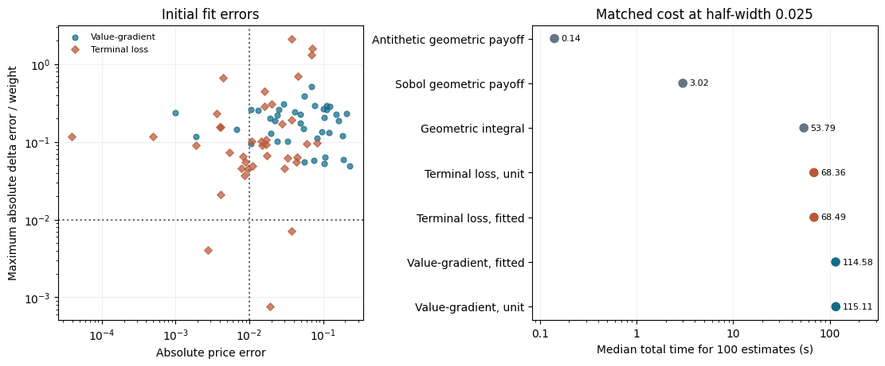

# Deep BSDE Pricing and Basket Greeks

## Research question

Two neural BSDE formulations are evaluated on synthetic European calls under
correlated geometric Brownian motion. The comparisons cover initial price and
spot risk, sensitivity to the time grid and basket dimension, and the cost of
reusing fitted controls in unbiased pricing estimators. The locked design
contains 78 fits and 48 estimator repetitions across three training seeds.
All scheduled jobs completed.

Seventeen fits met the price tolerance and three met every coordinate-delta
tolerance. One vanilla terminal-loss fit passed both. On the ten-asset
arithmetic call, antithetic and scrambled Sobol geometric-payoff controls
were cheaper than either learned formulation at matched precision. The
[research notebook](../notebooks/deep_bsde_study.ipynb) computes the tables
and figures from the [retained results](results.json).

The left panel shows every initial fit, including the additional ten-asset
grids. Dashed lines are point-error thresholds. The numerical-reference
intervals determine the formal pass decisions. The right panel shows Mac
median total cost at 100 queries and half-width 0.025, using the smallest
qualifying allocation separately for each seed and method.

## 1. Model and valuation

Let $S^i$ be a spot, $r$ the continuous rate, $q_i$ the continuous dividend
yield and $\sigma_i$ the annualized volatility. Time is in years. With
independent Brownian components $W$ and $LL^\top=\rho$,

$$
dS_t=b(S_t)\,dt+\Sigma(S_t)\,dW_t,\qquad
b_i(s)=(r-q_i)s_i,\qquad
\Sigma(s)=\operatorname{diag}(s_i\sigma_i)L.
$$

For a step $h$, the simulator uses the exact lognormal transition

$$
S^i_{t+h}=S^i_t\exp\left((r-q_i-\tfrac12\sigma_i^2)h
                         +\sigma_i(L\Delta W)_i\right),
\qquad \Delta W\sim N(0,hI).
$$

The basket $B(s)$ is either $\sum_i w_i s_i$ or $\prod_i s_i^{w_i}$,
with positive weights summing to one. For payoff $g(s)=(B(s)-K)^+$ and
$\tau=T-t$, $u(t,s)=e^{-r\tau}\mathbb E[g(S_T)\mid S_t=s]$. The pricing
PDE follows from the diffusion generator,

$$
u_t+b^\top\nabla u+\tfrac12\operatorname{tr}(\Sigma\Sigma^\top D^2u)-ru=0,
\qquad u(T,s)=g(s).
$$

The spot diffusion covariance is $\Sigma\Sigma^\top$. The Brownian
control below uses the independent coordinates of $W$. A payoff estimator
can sample $S_T$ directly. The path grids are used by the BSDE objectives
and stochastic-integral controls.

## 2. Independent prices and Greeks

### Exact and numerical benchmarks

For a single spot, Black–Scholes gives the call price and its derivatives.
The notebook also recomputes an independent one-dimensional PDE check.
It uses Crank–Nicolson on a truncated spot domain, $u(\tau,0)=0$ and
$u(\tau,S_{\max})\approx S_{\max}e^{-q\tau}-Ke^{-r\tau}$. Initial
backward-Euler half steps damp oscillations from the payoff kink.
Joint refinement checks price, delta and gamma at the initial spot.

For a geometric basket, let $a_i=w_i\sigma_i$, $v=a^\top\rho a$ and
$m=\sum_iw_i(r-q_i-\sigma_i^2/2)$. The log basket return is normal with
mean $m\tau$ and variance $v\tau$. A scalar Black–Scholes call evaluated at
$G=\prod_i s_i^{w_i}$ therefore uses $\sqrt v$ and effective yield
$q_{\rm eff}=r-m-v/2$. Its coordinate delta is
$\Delta_i=C_G\,w_iG/s_i$.

For the arithmetic call with positive remaining variance, differentiating
under the expectation gives

$$
\Delta_i=e^{-r\tau}\mathbb E\left[
  \mathbf 1_{\{B(S_T)>K\}} w_i S_T^i/s_i\mid S_t=s
\right].
$$

The payoff kink has probability zero in the numerical reference cases.
The first derivative is dominated by an integrable lognormal multiple.
A second derivative differentiates the exercise boundary as well. The
study reports arithmetic coordinate deltas and the vanilla value-gradient
gamma.

### Sampling and reference gates

Geometric payoff and geometric delta contributions supply control variates
with known expectations. For a target contribution $X$ and control $C$,
$X-\beta(C-\mathbb E C)$ retains the same mean when $\beta$ is fitted on an
independent pilot. Each coordinate has its own pilot coefficient. The
antithetic standard error uses independent pair averages. For randomized
Sobol, it uses the standard deviation of independent scramble means
divided by $\sqrt R$, with a Student-$t$ interval at $R-1$ degrees of freedom.
The intervals are approximate and pointwise.

The primary reference uses 16 scrambled nets with $2^{16}$ terminal states
per net at the first level. The cross-check uses 131,072 independent
antithetic pairs. Both methods use independent 4,096-pair pilots. The
price half-width and each half-width divided by $w_i$ must be at most
0.002. Each difference between the two methods must also be within four
combined standard errors, $\sqrt{\mathrm{SE}_{\rm Sobol}^2+
\mathrm{SE}_{\rm anti}^2}$. The second allocation is reserved for cases
that fail these gates.

All eight arithmetic references qualified at the first level. The largest
price half-width was 0.0005613, the largest scaled-delta half-width was
0.0005672, and the largest inter-method difference was 1.95 combined
standard errors. The price reference for the base ten-asset call was
6.40618543 with a 95% half-width of 0.0004891. The price and coordinate
delta references, confidence intervals and agreement diagnostics are in the
[retained data](results.json).

## 3. BSDE formulations and sources of error

### Discounted dynamics and losses

Itô's formula and the PDE give $dY_t=rY_t\,dt+Z_t^\top dW_t$ with
$Y_t=u(t,S_t)$ and $Z_t=\Sigma(S_t)^\top\nabla_su(t,S_t)$. Write
$\widetilde Y_t=e^{-rt}Y_t$ and $\widetilde Z_t=e^{-rt}Z_t$. The
discounted dynamics are $d\widetilde Y_t=\widetilde Z_t^\top dW_t$,
with terminal value $X=e^{-rT}g(S_T)$.

The value-gradient solver learns one function $u_\theta(t,s)$ and
differentiates it in physical spot units. Set
$\widetilde Z_j=e^{-rt_j}\Sigma(S_{t_j})^\top\nabla_s u_\theta(t_j,S_{t_j})$.
For the locked terminal weight of one, its population objective is

$$
\frac{1}{K^2}\mathbb E\left[\sum_{j=0}^{N-1}
  (\widetilde Y_{j+1}-\widetilde Y_j-\widetilde Z_j^\top\Delta W_j)^2
  +(\widetilde Y_N-X)^2\right].
$$

The terminal-loss solver learns a free scalar $y$ and a free initial
discounted control. One state-only network at each later grid point supplies
the remaining controls. It propagates
$\widetilde Y_N=y+\sum_j\widetilde Z_j^\top\Delta W_j$ and minimizes
$\mathbb E[(\widetilde Y_N-X)^2]/K^2$. Both formulations use two hidden
tanh layers of width 16. The terminal architecture grows with the grid.
These formulations are related to the Deep BSDE and forward-backward
stochastic neural network methods. [Han, Jentzen and E](https://arxiv.org/abs/1707.02568) ·
[Raissi](https://arxiv.org/abs/1804.07010)

### What the terminal objective controls

For square-integrable predictable controls and exact forward paths, the
martingale representation of $X$ and Itô isometry give

$$
\mathbb E[(y+\textstyle\sum_j\widehat Z_j^\top\Delta W_j-X)^2]
=(y-u(0,S_0))^2+\sum_j\int_{t_j}^{t_{j+1}}
   \mathbb E\|\widehat Z_j-\widetilde Z_t\|^2\,dt .
$$

The best square-integrable left-endpoint control on an interval is the
conditional average $h_j^{-1}\mathbb E[\int_{t_j}^{t_{j+1}}
\widetilde Z_t\,dt\mid\mathcal F_{t_j}]$. This follows by orthogonal
projection onto $\mathcal F_{t_j}$-measurable vectors. The integrated
loss weights the initial control by the length of the first interval.
Pointwise Greek accuracy requires its own check.

The experiment combines a grid projection error, approximation error
within the network classes, finite-sample checkpoint selection and
optimization error. Exact GBM transitions remove an Euler error in the
forward state. They leave the control projection and both fitted losses
grid-dependent. The comparisons measure their combined effect.

Han and Long bound a simulation error by a small time-step term and
the **population** terminal discrepancy for their discretized scheme.
Their hypotheses include Lipschitz and time regularity conditions,
integrability and quantitative restrictions on coupling or monotonicity.
The approximation result concerns the infimum over function classes.
These results motivate distinguishing grid and terminal errors. Their
bounds apply to the analyzed scheme and its population objective. The
shared value-gradient loss and the finite Adam training budget are
assessed empirically here.
The geometric payoff also requires care with global regularity near
the positive-orthant boundary. [Han and Long, Theorems 1 and 2](https://arxiv.org/abs/1811.01165)

### Delta recovery

The terminal solver recovers spot risk from
$\Sigma(s)^\top\Delta=e^{rt}\widetilde Z_t$. At a fixed spot, control
error can be amplified by $\|\Sigma(s)^{-\top}\|$. A small reconstruction
residual verifies the linear solve. Accuracy is measured against the
independent deltas. A single terminal-loss scalar has no spot derivative
from which to extract gamma. The value-gradient gamma instead comes from
the second derivative of its learned value surface.

For arithmetic calls, $0\le\Delta_i\le w_i e^{-q_i\tau}$. For geometric
calls the corresponding ceiling is $e^{-q_{\rm eff}\tau}w_iG/s_i$.
The result data records economic-bound violations without clipping.

## 4. Locked design and solver results

The base arithmetic call has spot and strike 100, maturity one year,
rate 3%, volatility 20%, zero dividends and pairwise correlation 0.30.
Weights are equal. The base grid uses 16 intervals. The additional
ten-asset grids use 10, 20 and 40 intervals. Four ten-asset stresses change
the strike to 90 or 110, maturity to 0.25 years, or correlation to 0.80.
The vanilla and asymmetric geometric cases complete the ten contracts.
The [design](../bsde_pricing/design.json) records the parameters and seeds.

The fits use CPU float64, 3,000 Adam updates, batches of 128 fresh paths,
and learning rate 0.001 reduced to 0.0003 after 70% of the updates. Each
checkpoint is selected on its formulation's own validation objective
using the reserved 256-path validation sample and scheduled evaluations
every 100 updates. Conditional diagnostics use a separate 2,048-path
evaluation where the analytical quantity is available. Reference pilots,
training, validation, path evaluation, and estimator pilots and evaluation
have separate random streams. The final training seeds are 41001–41003.

### Acceptance and seed variation

The price tolerance is 0.01 price units. The coordinate tolerance is
0.01 in $\Delta_i/w_i$. For signed error $e$ against a numerical
reference with half-width $h$ in the same units, $|e|+h\le0.01$ passes and
$|e|-h>0.01$ fails. Overlap is unresolved. A joint pass requires a
price pass and a pass on every coordinate.

| Formulation | Completed fits | Price passes | All-coordinate delta passes | Joint passes | Fits with a delta bound violation |
| --- | ---: | ---: | ---: | ---: | ---: |
| Value-gradient | 39 | 3 | 0 | 0 | 4 |
| Terminal loss | 39 | 14 | 3 | 1 | 6 |

The lone joint pass was the vanilla terminal-loss fit with seed 41002,
with signed price error −0.002763 and delta error +0.004032. The
ten-asset terminal fit at seed 41003 and 16 intervals illustrates the
difference between the metrics. Its absolute price error was about
0.000039 and its worst scaled delta error was 0.1171. All three vanilla
value-gradient gamma estimates were below the analytical value of 0.01933.
They ranged from 0.00200 to 0.00468 across seeds.

### Dimension and grid

At equal spot levels and fixed equicorrelation the basket's initial
relative variance is $\sigma^2[\rho+(1-\rho)/d]$. Changing $d$ changes
diversification as well as input dimension. At 100 assets, initial
absolute price errors spanned 0.0373–0.0711. The worst scaled coordinate
error by seed spanned 0.245–0.518 for value-gradient and 1.318–2.134 for
terminal loss. The notebook retains individual seed points for the
dimension ladder and contract stresses.

Six of the 24 ten-asset grid fits passed the price test. One price result
was unresolved and all 24 missed the joint target. The median absolute
price errors for value-gradient at 10, 16, 20 and 40 intervals were
0.0131, 0.0236, 0.1110 and 0.0293. The corresponding terminal-loss
medians were 0.0147, 0.0088, 0.0082 and 0.0150. No monotone pattern
appeared under the fixed budget. The terminal model also grew from 5,573
to 24,113 parameters between 10 and 40 intervals. The study measures
finite-budget sensitivity to the grid rather than a convergence order.

## 5. Frozen controls at matched precision

### Mean and variance

For a fitted control frozen independently of the evaluation increments,
$I=\sum_j \widehat Z_j^\top\Delta W_j$ has mean zero conditional on the
fit. The same holds conditional on an independent pilot for $\beta$,
so $X-\beta I$ targets the discounted payoff mean. For nonzero variance,
the variance-minimizing scalar is
$\operatorname{Cov}(X,I)/\operatorname{Var}(I)$. In antithetic experiments
the covariance and variance are computed on pair averages. The known
geometric control checks the integral mean and the discrete Itô isometry.
An unbiased estimator may still have higher variance or cost.

### Allocation and total cost

The comparison fixes the base ten-asset call and 16 time intervals.
For each pair of fitted checkpoints, 16 independent repetitions compare
the two conventional geometric-payoff controls, the analytical geometric
integral used as a proxy, and unit and pilot-fitted coefficients for both
learned controls. The allocations use 8,192, 32,768 or 131,072 terminal
states. Antithetic estimators average across independent pairs.
The Sobol estimator divides the allocation across 16 independent
scrambles. The precision rule requires all 16 intervals at the selected
allocation to have half-width at most the target. This is an observed
qualification rule for the tested allocations.

Total cost for $q$ independent estimates is
$C(q)=C_{\rm fit}+C_{\rm load}+C_{\rm pilot}+qC_{\rm eval}$. Per-cohort
setup and evaluation use the measured medians where applicable. The
fit and coefficient are reused for the fixed contract. Conventional payoff
controls require only terminal sampling. Learned controls evaluate the
full grid. Sustained break-even needs a lower marginal cost, or equal
marginal cost with a lower or equal upfront charge.

| Method | Qualifying cohorts at 0.025 | Terminal states at 0.025 | Median cost for 100 estimates | Qualifying cohorts at 0.01 |
| --- | ---: | ---: | ---: | ---: |
| Antithetic geometric payoff | 3 / 3 | 8,192 | 0.14 s | 3 / 3 |
| Sobol geometric payoff | 3 / 3 | 8,192 | 3.02 s | 3 / 3 |
| Geometric integral | 3 / 3 | 32,768 | 53.79 s | 3 / 3 |
| Value-gradient, unit coefficient | 3 / 3 | 32,768–131,072 | 115.11 s | 0 / 3 |
| Value-gradient, fitted coefficient | 3 / 3 | 32,768 | 114.58 s | 0 / 3 |
| Terminal loss, unit coefficient | 3 / 3 | 32,768 | 68.36 s | 0 / 3 |
| Terminal loss, fitted coefficient | 3 / 3 | 32,768 | 68.49 s | 0 / 3 |

Both conventional controls cost less per estimate at matched precision in
every cohort. The fitted control or pilot coefficient could therefore be
reused indefinitely in this timing model without achieving a sustained
break-even. At the tighter half-width, the geometric integral qualified
at 131,072 states in each cohort. The conventional controls qualified
with at most 32,768 states.

## 6. Reproduction and scope

The [result file](results.json) contains all scheduled
jobs, reference intervals, per-seed error vectors, estimator allocations
and runtime metadata. The [notebook](../notebooks/deep_bsde_study.ipynb)
uses that file for the reported tables and its final figure supplies the
illustration above. Small demonstrations call the same pricing,
finite-difference, sampling and martingale implementations as the CLI.
They use their own seeds and allocations.

~~~sh
conda activate bsde-pricing
python -m bsde_pricing experiment-design
python -m bsde_pricing final-suite --run-dir scratch/runs/final_suite
python -m bsde_pricing summarize scratch/runs/final_suite/report.json scratch/runs/final_suite/summary.json
python -m unittest discover -s tests
~~~

The complete Mac run used Python 3.12.16, NumPy 2.5.4, SciPy 1.18.1 and
PyTorch 2.15.0 and took 33 minutes 7 seconds of guarded worker time. The
Linux run reproduced all checkpoint selections, price and delta
classifications and matched allocations. Its measured workers took about
97 minutes, excluding an interruption. Timing levels describe those runs.

This is a study of fixed European contracts in a synthetic, constant-
coefficient, complete-market model. Exact or high-precision benchmarks
isolate numerical performance from market calibration. The seed and
contract sample bounds the empirical comparison. Costs are for repeated
queries of one fixed contract and accuracy is measured at the stated
starting states and on the available held-out paths.
