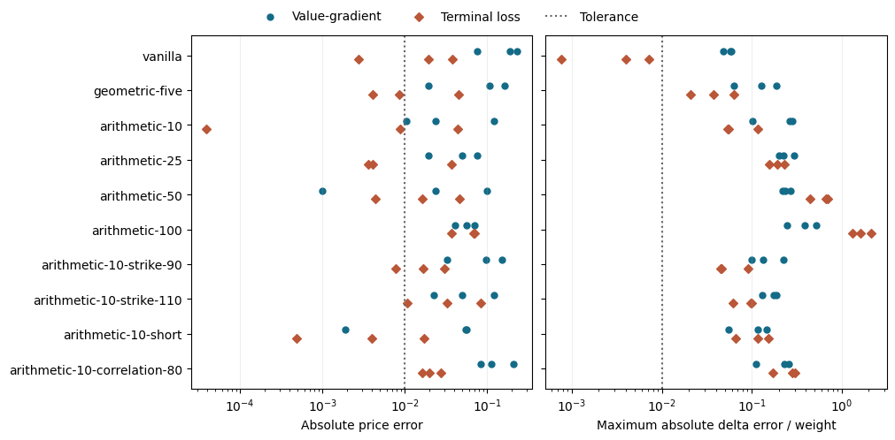

# Deep BSDE Methods for Basket Option Pricing and Spot Risk

**Research report · European calls under correlated geometric Brownian motion**

## Abstract

This study asks whether two neural solvers for the backward stochastic
differential equation (BSDE) of a European basket call can recover both its
initial value and its spot sensitivities, and whether their learned controls
can reduce the total cost of Monte Carlo pricing. One formulation
approximates a differentiable value function. The other fits an initial
value and a sequence of Brownian controls by minimizing a terminal
replication error. Exact vanilla and geometric prices, a one-dimensional
finite-difference check, and independent arithmetic-basket references
separate numerical error from uncertainty in the benchmark.

The locked study contains 78 fits across ten contracts with up to 100
assets and 48 estimator repetitions. Seventeen fits meet the initial price
target, three meet every coordinate-delta target, and one meets both. At
100 assets all six fits miss the price target. On a separate ten-asset
experiment, the cheapest learned control costs 68.36 seconds for 100
estimates at a 0.025 confidence-interval half-width, compared with 0.14
seconds for an antithetic geometric-payoff control on the recorded Mac.
The results identify where accurate prices, accurate Greeks, and
computationally useful controls diverge.

**Keywords** · Forward-backward SDEs, basket options, pathwise Greeks,
randomized quasi-Monte Carlo, martingale control variates.

## Contents

1. [Model and valuation](#1-model-and-valuation)
2. [Independent prices and Greeks](#2-independent-prices-and-greeks)
3. [BSDE formulations and sources of error](#3-bsde-formulations-and-sources-of-error)
4. [Experimental design](#4-experimental-design)
5. [Valuation and Greek results](#5-valuation-and-greek-results)
6. [Martingale controls and estimator cost](#6-martingale-controls-and-estimator-cost)
7. [Conclusions and further research](#7-conclusions-and-further-research)
8. [Reproduction](#8-reproduction)
9. [References](#references)

## 1. Model and valuation

### 1.1 Research questions

A neural BSDE objective can be small while a coordinate hedge is wrong.
Even a control that is too inaccurate for hedging may still remove some
payoff variance. The study therefore evaluates three distinct quantities.

| Question | Measure | Benchmark |
| --- | --- | --- |
| Can the solver price the contract at inception? | Absolute initial price error | Analytical or independently qualified numerical price |
| Can it recover the spot risk? | Error in every weight-scaled delta, delta bounds, and selected gamma | Analytical and pathwise Greeks |
| Can its frozen control improve a price estimator? | Total cost at an observed interval half-width | Antithetic and randomized Sobol geometric-payoff controls |

European calls under a constant-parameter model make each comparison
observable. Direct terminal simulation is available and the geometric
case provides exact multi-asset values and Greeks. The arithmetic payoff
adds a coupled exercise boundary. The use of synthetic contracts isolates
solver and sampling behavior from calibration error.

### 1.2 Risk-neutral model

Under the pricing measure, $`W`$ is a standard $`d`$-dimensional Brownian
motion with independent components. The asset correlation matrix is
$`\rho=LL^\top`$. With a continuously compounded rate $`r`$, dividend
yields $`q_i`$ and annualized volatilities $`\sigma_i`$,

```math
\begin{aligned}
dS_t &= b(S_t)\,dt+\Sigma(S_t)\,dW_t, \\
b_i(s) &= (r-q_i)s_i, \\
\Sigma(s) &= \mathrm{diag}(s_i\sigma_i)L.
\end{aligned}
```

Multiplying the diffusion by its transpose gives spot covariance per
unit time. The off-diagonal entries $`s_i s_j\sigma_i\sigma_j\rho_{ij}`$
enter the pricing operator through mixed second derivatives. The
simulator uses the exact transition on an interval of length $`h`$.

```math
\begin{aligned}
S_{t+h}^i &= S_t^i \exp\!\left[
  \left(r-q_i-\tfrac{1}{2}\sigma_i^2\right)h
  +\sigma_i(L\Delta W)_i\right], \\
\Delta W &\sim \mathcal{N}(0,hI).
\end{aligned}
```

Exact forward transitions are available because the coefficients of
the log spots are constant. Reference estimators for terminal payoffs
use one transition to expiry. The neural objectives and stochastic
integrals require intermediate states.

### 1.3 Payoff and pricing equation

The arithmetic and geometric baskets use positive weights summing to one.

```math
A(s)=\sum_{i=1}^d w_i s_i,
\qquad
G(s)=\prod_{i=1}^d s_i^{w_i}.
```

For $`B`$ equal to $`A`$ or $`G`$, the call pays
$`g(s)=(B(s)-K)^+`$ at maturity $`T`$. Write $`\tau=T-t`$.
Risk-neutral valuation and the Feynman–Kac equation give

```math
\begin{aligned}
u(t,s)&=e^{-r\tau}\mathbb{E}^{\mathbb{Q}}[g(S_T)\mid S_t=s], \\
0&=u_t+b^\top\nabla_s u+
   \tfrac{1}{2}\mathrm{tr}(\Sigma\Sigma^\top D_s^2u)-ru, \\
u(T,s)&=g(s).
\end{aligned}
```

Spot delta is $`\nabla_s u`$ in physical spot units. Gamma is the
second spot derivative in the vanilla problem. The diffusion-weighted
gradient enters the BSDE in Section 3.

## 2. Independent prices and Greeks

### 2.1 Vanilla reference and finite-difference refinement

For the vanilla call with positive volatility and time to expiry,
define

```math
d_1=\frac{\log(s/K)+(r-q+\sigma^2/2)\tau}{\sigma\sqrt{\tau}},
\qquad d_2=d_1-\sigma\sqrt{\tau}.
```

With standard normal distribution
function $`\Phi`$ and density $`\phi`$,

```math
\begin{aligned}
C &= s e^{-q\tau}\Phi(d_1)-K e^{-r\tau}\Phi(d_2), \\
\Delta &= e^{-q\tau}\Phi(d_1), \\
\Gamma &= \frac{e^{-q\tau}\phi(d_1)}{s\sigma\sqrt{\tau}}.
\end{aligned}
```

The independent PDE check marches from the terminal payoff in increasing time to expiry on a
truncated spot grid, with zero value at zero spot and the discounted
intrinsic asymptote at the upper boundary. Crank–Nicolson is initialized
with backward-Euler half steps to damp oscillations from the payoff kink.
At 800 intervals in both dimensions, signed differences from Black–Scholes
at the initial spot were −0.000613 in price, −0.0000135 in delta, and
+0.00000171 in gamma. The executed notebook retains the refinement table.

### 2.2 Geometric basket reduction

The log of the geometric basket is a linear combination of log spots.
Set $`a_i=w_i\sigma_i`$. Its conditional log return is normal with mean
$`m\tau`$ and variance $`v\tau`$, where

```math
\begin{aligned}
m &= \sum_i w_i(r-q_i-\sigma_i^2/2), \\
v &= a^\top\rho a,\qquad
q_{\mathrm{eff}}=r-m-v/2.
\end{aligned}
```

A scalar Black–Scholes calculation at spot $`G(s)`$, volatility $`\sqrt{v}`$
and yield $`q_{\mathrm{eff}}`$ gives the exact price. Applying the chain
rule to the scalar delta $`C_G=\partial C/\partial G`$ gives
$`\Delta_i=C_G w_iG(s)/s_i`$. This reference checks coordinate sensitivities
in a case with unequal weights, volatilities, yields and mixed-sign
correlations.

### 2.3 Arithmetic basket pathwise deltas

A terminal spot is proportional to its own starting spot under the
exact transition. For a nondegenerate call the exercise boundary has
probability zero, and the payoff derivative is dominated by an
integrable lognormal multiple. Differentiating under the expectation gives

```math
\Delta_i=e^{-r\tau}\mathbb{E}^{\mathbb{Q}}\!\left[
\mathbf{1}_{\{A(S_T)>K\}}\,w_i\frac{S_T^i}{s_i}
\;\middle|\;S_t=s
\right].
```

Dropping the indicator gives the upper bound $`w_i e^{-q_i\tau}`$.
For the geometric call the corresponding bound is
$`e^{-q_{\mathrm{eff}}\tau}w_iG(s)/s_i`$. A second derivative of the
arithmetic call involves the exercise boundary, so the arithmetic
reference study uses coordinate deltas. Vanilla gamma provides the
separate curvature check.

### 2.4 Reference variance and acceptance

The geometric payoff and its pathwise deltas supply control variables
with exact means. For a discounted contribution $`H`$ and a corresponding
geometric control $`C`$, each estimate averages
$`H-\beta(C-\mathbb{E}[C])`$. The price and each delta coordinate have
separate coefficients fitted on independent pilot paths. This keeps
the estimate centered at its target conditional on the pilot.

| Reference component | Locked choice |
| --- | --- |
| Primary estimator | 16 independent scrambled Sobol nets, each with 65,536 terminal states at the first level |
| Cross-check | 131,072 independent antithetic pairs at the first level |
| Coefficient pilot | Separate 4,096-pair pilot for each reference method |
| Uncertainty units | Independent scramble means for Sobol, independent pair averages for antithetic sampling |
| Precision gate | Approximate 95% half-width at most 0.002 for price and each weight-scaled delta |
| Agreement gate | Absolute method difference at most four combined standard errors for every reported quantity |

For $`R`$ scrambles, standard error is the sample standard deviation of the
$`R`$ means divided by $`\sqrt{R}`$. The interval uses the Student critical
value with $`R-1`$ degrees of freedom. Antithetic standard errors use the
sample variance of pair averages and a normal critical value. Combining
the standard errors in quadrature uses independent streams across the
two estimates. These are pointwise intervals.

**Table 1. Reference precision and independent agreement.** A dash marks
an analytical reference for which sampling diagnostics do not apply.

| Contract | Reference price | Price half-width | Max scaled-delta half-width | Max gap / combined SE |
| --- | --- | --- | --- | --- |
| Vanilla | 9.413403 | — | — | — |
| Geometric, five assets | 5.494719 | — | — | — |
| Arithmetic, 10 assets | 6.406185 | 0.000489 | 0.000386 | 1.83 |
| Arithmetic, 25 assets | 6.132674 | 0.000516 | 0.000567 | 1.42 |
| Arithmetic, 50 assets | 6.038341 | 0.000553 | 0.000442 | 1.95 |
| Arithmetic, 100 assets | 5.990219 | 0.000520 | 0.000470 | 1.29 |
| Strike 90 | 13.422761 | 0.000398 | 0.000321 | 1.31 |
| Strike 110 | 2.349156 | 0.000561 | 0.000412 | 1.78 |
| Short maturity | 2.809889 | 0.000175 | 0.000237 | 1.50 |
| High correlation | 8.683692 | 0.000123 | 0.000233 | 1.48 |

Every arithmetic case qualified at the first level. The widest price and
scaled-delta half-widths were 0.0005613 and 0.0005672. The largest
method discrepancy was 1.95 combined standard errors. This leaves the
0.01 fit tolerances substantially wider than the numerical reference
uncertainty.

## 3. BSDE formulations and sources of error

### 3.1 Discounted martingale representation

Let $`Y_t=u(t,S_t)`$ and $`Z_t=\Sigma(S_t)^\top\nabla_s u(t,S_t)`$.
Applying Itô's formula and substituting the PDE gives

```math
\begin{aligned}
dY_t &= rY_t\,dt+Z_t^\top dW_t, \\
d\widetilde{Y}_t &= \widetilde{Z}_t^\top dW_t,\qquad
\widetilde{Y}_T=X, \\
\widetilde{Y}_t &= e^{-rt}Y_t,\qquad
\widetilde{Z}_t=e^{-rt}Z_t,\qquad X=e^{-rT}g(S_T).
\end{aligned}
```

The driver in the convention $`dY_t=-f\,dt+Z_t^\top dW_t`$ is $`f=-rY_t`$.
Discounting removes that deterministic drift. The vector $`Z`$ is a
control in independent Brownian coordinates, with a factor of the
spot diffusion relative to the hedge vector.

### 3.2 Value-gradient approximation

One smooth network $`u_\theta(t,s)`$ is shared over time. The network
supplies a price at each grid point, and differentiation with respect to
physical spots supplies its delta and discounted control. On a path
grid $`t_0,\ldots,t_N`$, define the local defect

```math
R_j=\widetilde{Y}_{j+1}^{\theta}-\widetilde{Y}_j^{\theta}
    -(\widetilde{Z}_j^{\theta})^\top\Delta W_j .
```

The objective averages the sum of squared local defects and the terminal
payoff defect, with terminal weight one in the locked design.

```math
\mathcal{J}_{\mathrm{value}}(\theta)=
\frac{1}{K^2}\mathbb{E}\!\left[
  \sum_{j=0}^{N-1}R_j^2+(\widetilde{Y}_N^{\theta}-X)^2
\right].
```

The smooth value function permits a second derivative for gamma.
Automatic differentiation evaluates the derivatives of the fitted
function accurately in the chosen numerical precision. Their economic
accuracy depends on the learned function's local shape. This formulation
follows the value-and-gradient approach of Raissi and the FBSDE workshop
lineage represented by Güler, Laignelet and Parpas [2, 3].

### 3.3 Terminal-loss approximation

A scalar $`y`$ and an initial control are fitted directly at the fixed
starting state. A separate state-only network at each later grid point
outputs the discounted Brownian control $`\widehat{Z}_j`$. Discounted
value evolves by accumulation of the predicted stochastic increments.
The terminal objective is

```math
\mathcal{J}_{\mathrm{terminal}}=
\frac{1}{K^2}\mathbb{E}\!\left[
  \left(y+\sum_j\widehat{Z}_j^\top\Delta W_j-X\right)^2
\right].
```

The formulation follows the forward terminal-loss approach of Han,
Jentzen and E [1]. Hientzsch [4] describes both forward and backward
control formulations. The backward least-squares continuation scheme
of Liang, Xu and Li [5] addresses a different exercise problem. The
algorithms studied here have a fixed European terminal payoff.

### 3.4 What a terminal loss measures

The exact discounted payoff is the initial price plus the martingale
integral of $`\widetilde{Z}_t`$. Subtracting that representation from the
discrete terminal prediction, the deterministic initial error is
orthogonal to the mean-zero stochastic error. Itô isometry yields

```math
\begin{aligned}
&\mathbb{E}\!\left[
  \left(y+\sum_j\widehat{Z}_j^\top\Delta W_j-X\right)^2\right] \\
&\quad = (y-u(0,S_0))^2+
\sum_j\int_{t_j}^{t_{j+1}}
  \mathbb{E}\bigl[\|\widehat{Z}_j-\widetilde{Z}_t\|^2\bigr]\,dt.
\end{aligned}
```

For square-integrable controls measurable at the left endpoint, the
optimal control for each interval is the conditional time average.

```math
Z_j^\star=\frac{1}{t_{j+1}-t_j}\,
\mathbb{E}\!\left[
  \int_{t_j}^{t_{j+1}}\widetilde{Z}_t\,dt
  \;\middle|\;\mathcal{F}_{t_j}
\right].
```

Orthogonal projection separates the error of restricting the control
to this grid from the error of approximating the projection. The first
interval contributes in proportion to its length. The resulting
integrated squared control error and the initial coordinate hedge error
are distinct diagnostics.

The experiment also includes finite-capacity approximation, finite
validation samples and a fixed optimization budget. The convergence
analysis of Han and Long [6] makes assumptions on the coefficients,
regularity and discretization, and uses population errors. The
reported fits are empirical results for the specified training
procedures. Exact GBM removes forward-state discretization error,
while grid projection and optimization effects remain.

### 3.5 Spot-risk recovery and conditioning

The terminal model's discounted output is first converted to its
time-$`t`$ Brownian control. A transposed linear solve then recovers
the spot delta. For a control error $`\delta Z`$ at the same state,

```math
\begin{aligned}
\Sigma(s)^\top\Delta &= e^{rt}\widehat{Z}_t, \\
\|\delta\Delta\|_2 &\le
  \frac{\|\delta Z\|_2}{\sigma_{\min}(\Sigma(s))}.
\end{aligned}
```

Here $`\delta Z`$ is in undiscounted control units. The smallest singular
value controls absolute error amplification, while the condition
number describes relative sensitivity of the linear solve. A small
residual checks that the solver recovered the hedge implied by the
network. The independent reference checks whether that hedge is
accurate. Bounds are evaluated on raw outputs. The terminal model
fits a scalar at inception, so the reported gamma diagnostic is for
the differentiable value model.

## 4. Experimental design

### 4.1 Contracts and input variation

All inputs are synthetic. Spots, strikes and prices share a currency
unit. Time is in years and rate, dividend yield and volatility are
annualized. The study uses constant coefficients within each contract.

| Contract group | Dimensions | Inputs |
| --- | --- | --- |
| Vanilla | 1 | Spot and strike 100, one year, rate 3%, volatility 20%, zero dividends |
| Asymmetric geometric | 5 | Strike 100, one year, rate 3%, heterogeneous spots, weights, volatilities, yields and factor loadings |
| Arithmetic scaling | 10, 25, 50, 100 | Equal weights, each spot 100, strike 100, one year, rate 3%, volatility 20%, zero dividends, pairwise correlation 0.30 |
| Arithmetic stresses | 10 | Change one base input at a time to strike 90, strike 110, maturity 0.25 years, or correlation 0.80 |

The geometric vector uses spots (90, 100, 110, 95, 105), weights
(0.10, 0.15, 0.20, 0.25, 0.30), volatilities (16%, 19%, 23%, 26%, 31%)
and yields (0.5%, 1%, 1.5%, 2%, 2.5%). The correlation has unit diagonal
and off-diagonal entries $`\rho_{ij}=\ell_i\ell_j`$, with loadings
(0.65, 0.50, −0.35, 0.45, 0.55).

Each contract uses 16 time intervals, two solvers and three training
seeds. The base ten-asset contract also uses 10, 20 and 40 intervals,
giving 60 base-grid and 18 additional fits. The final design and
stream identifiers are recorded in the [locked specification](../bsde_pricing/design.json).

### 4.2 Numerical techniques and controls

| Technique | Numerical purpose | Verification |
| --- | --- | --- |
| Exact lognormal transitions | Simulate correlated spot paths and direct terminal states | Compare vanilla and geometric valuation against analytical prices and Greeks |
| Crank–Nicolson with backward-Euler startup | Solve the scalar pricing PDE independently | Refine the grid and check price, delta and gamma |
| Pathwise differentiation | Estimate the arithmetic coordinate deltas | Check analytical limits and independent sampling estimates |
| Randomized Sobol and antithetic sampling | Reduce reference variance using known geometric expectations | Independent scramble and pair diagnostics with precision and agreement gates |
| PyTorch differentiation and Adam | Fit the value-gradient and terminal-loss formulations | Select checkpoints on reserved paths, then evaluate against separate references |
| Predictable stochastic integrals [7] | Reuse fitted controls in unbiased price estimation | Check mean and discrete isometry using a known integrand, then compare total cost at matched precision |

Both neural formulations use two tanh hidden layers of width 16 and
CPU float64. Each run schedules 3,000 Adam updates, batches of 128 fresh
paths, and learning rate 0.001 reduced to 0.0003 after 70% of updates.
Checkpoint selection uses the lowest scheduled validation loss on 256
reserved paths, evaluated every 100 updates. Separate path diagnostics
use 2,048 paths. Reference, training, validation, path evaluation and
estimator streams are separate. The three final training seeds are
41001, 41002 and 41003. The study keeps every scheduled fit and evaluates
the chosen checkpoint for each seed.

### 4.3 Decision rules

The targets are 0.01 in absolute price units and 0.01 in each delta
divided by its basket weight. For signed error $`e`$ relative to the
reference center, half-width $`h`$ in the same units, and tolerance
$`\varepsilon=0.01`$, the classification is

```math
\begin{aligned}
\mathrm{Pass} &\quad |e|+h\le\varepsilon, \\
\mathrm{Miss} &\quad |e|-h>\varepsilon, \\
\mathrm{Unresolved} &\quad \text{otherwise}.
\end{aligned}
```

For analytical references $`h=0`$. A joint pass requires the price and
every coordinate to pass. The reference intervals are pointwise. The
all-coordinate rule is an operational screen and carries no nominal
simultaneous confidence level. Training seed dispersion is reported
separately from the uncertainty in the reference estimates.

## 5. Valuation and Greek results

### 5.1 Initial accuracy

**Table 2. Initial accuracy across all 78 fits.** A bound violation
means at least one raw coordinate falls outside its call delta range.

| Formulation | Fits | Price passes | All-coordinate delta passes | Joint passes | Fits with a delta bound violation |
| --- | ---: | ---: | ---: | ---: | ---: |
| Value-gradient | 39 | 3 | 0 | 0 | 4 |
| Terminal loss | 39 | 14 | 3 | 1 | 6 |

The joint pass was the vanilla terminal-loss fit at seed 41002. Its
signed errors were −0.002763 in price and +0.004032 in delta. The
16-interval terminal fit of the ten-asset base case at seed 41003
had price error 0.0000392 in absolute terms, alongside a worst scaled
coordinate error of 0.1171. A price acceptance decision therefore
provides little assurance about individual hedge ratios in this study.



**Figure 1. Errors across the 16-interval contracts.** Each symbol
represents one training seed. The vertical lines show the point-error
targets. Table 2 uses the reference-aware rule, so proximity to a line
alone does not determine classification. The exceptionally small
ten-asset price error is paired with a delta error well beyond its
target.

### 5.2 Dimension and conditioning

At the common initial spot, the instantaneous relative variance of the
equal-weight arithmetic basket is

```math
\frac{1}{dt}\,\mathrm{Var}\!\left(\frac{dA_t}{A_t}\right)
  =\sigma^2\!\left[\rho+\frac{1-\rho}{d}\right].
```

The ladder changes the payoff distribution through diversification as
well as the network input size. The price falls from 6.406185 at ten
assets to 5.990219 at 100. All six 100-asset fits miss the price target,
with absolute errors between 0.0373 and 0.0711. Across the three seeds,
worst scaled coordinate error ranges from 0.245 to 0.518 for
value-gradient and from 1.318 to 2.134 for terminal loss.

At the common spot and volatility, the singular values of the diffusion
follow from the equicorrelation eigenvalues. The smallest one is
$`s\sigma\sqrt{1-\rho}`$ and the largest one is
$`s\sigma\sqrt{1+(d-1)\rho}`$. At correlation 0.30, the condition number
rises from 2.30 at ten assets to 6.62 at 100, while the norm of the
inverse stays at 0.0598. The rising condition number alone therefore
cannot explain the larger absolute hedge errors. The coordinate scaling
also becomes stricter in absolute delta units as weights fall.

In the ten-asset high-correlation stress, the inverse norm rises from
0.0598 to 0.1118. Terminal-loss worst scaled delta error reaches 0.3041
across seeds, compared with 0.1171 in the base case. The stress also
changes the payoff distribution and the fitted control. The observed
error change combines these effects with the weaker conditioning.

### 5.3 Payoff stresses and curvature

The ten-asset price reference ranges from 2.349156 at strike 110 to
13.422761 at strike 90. The short-maturity reference is 2.809889.
At strike 110, even the smallest observed terminal-loss absolute price
error across seeds was 0.01078. The short-maturity case yielded some
small initial price errors alongside scaled coordinate misses. These
cases show why conclusions based on a single at-the-money contract
would be fragile.

The three vanilla value-gradient gamma estimates lie between 0.00200 and
0.00468, compared with the exact 0.01933. The separate finite-difference
calculation recovers the analytical curvature much more closely. This
distinguishes accuracy of the second derivative of the learned surface
from accuracy of the numerical differentiation used for the reference.

### 5.4 Time grid

**Table 3. Fixed-budget grid sensitivity for the ten-asset base call.**
Each row aggregates three seeds. The worst delta is the maximum absolute
weight-scaled coordinate error over those seeds.

| Intervals | Formulation | Parameters | Median abs. price error | Worst scaled delta error | Price passes |
| --- | --- | --- | --- | --- | --- |
| 10 | Value-gradient | 481 | 0.01305 | 0.2534 | 0/3 |
| 10 | Terminal loss | 5,573 | 0.01468 | 0.1010 | 0/3 |
| 16 | Value-gradient | 481 | 0.02365 | 0.2860 | 0/3 |
| 16 | Terminal loss | 9,281 | 0.00879 | 0.1171 | 2/3 |
| 20 | Value-gradient | 481 | 0.11102 | 0.2933 | 0/3 |
| 20 | Terminal loss | 11,753 | 0.00820 | 0.0914 | 2/3 |
| 40 | Value-gradient | 481 | 0.02932 | 0.3035 | 1/3 |
| 40 | Terminal loss | 24,113 | 0.01505 | 0.1078 | 1/3 |

Six of the 24 grid fits pass on price. One price result is unresolved,
and every fit misses the joint target. The value-gradient price median
is lowest at 10 intervals, and the terminal-loss median is lowest at 20.
Increasing the grid changes the stochastic projection, the work per
update and the number of terminal-loss parameters. The results measure
sensitivity under the fixed update budget. A convergence-rate estimate
would require separating these effects.

## 6. Martingale controls and estimator cost

### 6.1 Mean preservation and variance

Freeze the learned integrand before evaluating it on independent
paths. Each $`\widehat{Z}_j`$ depends only on information available at
$`t_j`$. Conditioning on that information makes each Brownian increment
mean zero. Thus

```math
I=\sum_j \widehat{Z}_j^\top\Delta W_j,
\qquad
\mathbb{E}[I\mid \mathrm{fit}]=0.
```

A coefficient $`\beta`$ fitted on independent pilot paths preserves the
target mean when the final estimate averages $`X-\beta I`$. For an
evaluation draw conditional on the fit and pilot,

```math
\begin{aligned}
\mathrm{Var}(X-\beta I)
&=\mathrm{Var}(X)-2\beta\,\mathrm{Cov}(X,I) \\
&\quad+\beta^2\,\mathrm{Var}(I), \\
\beta^\star&=\frac{\mathrm{Cov}(X,I)}{\mathrm{Var}(I)}
\qquad \text{if }\mathrm{Var}(I)>0.
\end{aligned}
```

Under antithetic sampling, $`X`$ and $`I`$ in this variance calculation
are pair averages. The comparison includes both unit and fitted
coefficients. Mean preservation follows from predictability and the
independence of evaluation paths. Efficiency depends on how well the
integral removes payoff variation and on the cost of evaluating it.

### 6.2 Analytical control check

For the five-asset geometric call, the exact conditional gradient
supplies the integrand. On 16,384 shared independent paths, analytical
control variance reduction rises from 11.5 times at four intervals
to 165.9 times at 64. The integral mean and the discrete isometry
gap are each within 1.2 estimated standard errors of zero on the
tested grids. The finer grid captures more payoff variation. Grid
results share paths, and one price estimate is 2.06 standard errors
above the exact price. The executed notebook reports the full check.

### 6.3 Repeated-price benchmark

The cost study uses one ten-asset contract on the 16-interval grid.
Each of three seed cohorts contains 16 independent repetitions. The
allocation ladder uses 8,192, 32,768 and 131,072 terminal states.
Antithetic methods use pair means and the Sobol method uses 16
scramble means. A cohort qualifies at the smallest tested allocation
for which every one of its 16 observed half-widths meets the target.

Conventional geometric-payoff controls evaluate terminal states.
The geometric integral and learned controls evaluate intermediate
states as well. The fixed costs are charged once for each sequence
of $`q`$ estimates of the same contract.

```math
C(q)=C_{\mathrm{fit}}+C_{\mathrm{load}}+
     C_{\mathrm{pilot}}+qC_{\mathrm{eval}}.
```

**Table 4. Matched-precision costs for 100 estimates.** Costs are Mac
medians across qualifying cohorts. If different cohorts qualify at
different allocations, the table gives the range of selected terminal
state counts.

| Method | 0.025 cohorts | States | Cost (s) | 0.01 cohorts | States | Cost (s) |
| --- | --- | --- | --- | --- | --- | --- |
| Antithetic geometric payoff | 3/3 | 8,192 | 0.14 | 3/3 | 32,768 | 0.60 |
| Sobol geometric payoff | 3/3 | 8,192 | 3.02 | 3/3 | 8,192–32,768 | 2.51 |
| Geometric integral | 3/3 | 32,768 | 53.79 | 3/3 | 131,072 | 216.85 |
| Value-gradient, unit | 3/3 | 32,768–131,072 | 115.11 | 0/3 | — | — |
| Value-gradient, fitted | 3/3 | 32,768 | 114.58 | 0/3 | — | — |
| Terminal loss, unit | 3/3 | 32,768 | 68.36 | 0/3 | — | — |
| Terminal loss, fitted | 3/3 | 32,768 | 68.49 | 0/3 | — | — |


**Figure 2. Joint errors and matched cost.** The left panel includes
all 78 fits, including additional grids. The dashed lines show the
point-error targets. The right panel uses the costs at half-width
0.025 from Table 4. The logarithmic scale reflects the wide cost range.

At 0.025, both conventional geometric-payoff methods have lower
marginal cost in every cohort. Even repeated reuse cannot amortize a
higher marginal cost. At 0.01, both conventional methods qualify at
allocations of at most 32,768 terminal states and the geometric
integral qualifies at 131,072. Every learned variant misses the
tighter target at the tested allocations. The ranking describes
this fixed-contract workload on the recorded machine. Pricing across
different contracts would require a separately trained and tested
parameterized model and a different accounting of setup costs.

## 7. Conclusions and further research

Independent prices and Greeks were precise enough to distinguish
reference uncertainty from solver error. The high-dimensional fits
demonstrate that both formulations can be executed on the declared
grids. The observed price and hedge errors at 100 assets leave a
substantial gap to the specified tolerances. The price–delta example
in Section 5.1 shows why both gates are needed. The analytical
integrand check also distinguishes correct martingale construction
from the economic value of deploying a learned integrand.

The comparison is bounded by constant-coefficient synthetic contracts,
three seeds per condition, a fixed optimization budget and evaluation
at the declared starting states. Changes in dimension and grid affect
several mechanisms at once. Wall time reflects a single repeated
ten-asset workload and the recorded CPU environment.

Three extensions would address those specific limits.

1. **Pointwise risk and generalization.** Train over a declared domain
   of starting states and test prices, deltas and gammas on reserved
   states. Compare an objective that gives initial hedge error explicit
   weight against the two current losses.
2. **Grid and dimension effects.** Match optimization work or
   parameter count across grids. Vary dimension while holding initial
   basket variance or factor exposure fixed.
3. **Nonlinear financing.** Introduce a specified borrowing–lending
   spread and derive the resulting semilinear driver. An independently
   refined one-dimensional nonlinear PDE and the equal-rate limit
   would provide the first checks before scaling.

## 8. Reproduction

The [retained results](results.json) record per-fit errors and
classifications, numerical reference intervals, estimator allocations
and runtime metadata. The [executed notebook](../notebooks/deep_bsde_study.ipynb)
uses those records for the result figures and runs the small analytical
diagnostics through the package. The source fingerprint in the retained
results corresponds to the [v1.0.0 benchmark revision](https://github.com/KVInator/deep-bsde-pricing/releases/tag/v1.0.0).

From the repository root, create the pinned environment, list the
locked jobs and run the suite into a fresh directory.

~~~sh
conda env create -f environment.yml
conda activate bsde-pricing
python -m bsde_pricing experiment-design
python -m bsde_pricing final-suite --run-dir scratch/runs/final_suite
python -m bsde_pricing summarize scratch/runs/final_suite/report.json scratch/runs/final_suite/summary.json
~~~

The complete Mac run used Python 3.12.16, NumPy 2.5.4, SciPy 1.18.1
and PyTorch 2.15.0. It took 33 minutes 7 seconds of guarded worker time.
The Linux run reproduced checkpoint selections, accuracy classifications
and matched allocations and took about 97 minutes of measured worker
time, excluding an interruption. Those elapsed times describe the
recorded benchmark runs.

## References

1. Han, J., Jentzen, A., and E, W. (2018). [Solving high-dimensional partial differential equations using deep learning](https://arxiv.org/abs/1707.02568). *Proceedings of the National Academy of Sciences*, 115(34), 8505–8510.
2. Raissi, M. (2018). [Forward-Backward Stochastic Neural Networks](https://arxiv.org/abs/1804.07010). arXiv:1804.07010.
3. Güler, B., Laignelet, A., and Parpas, P. (2019). [Towards robust and stable deep learning algorithms for forward backward stochastic differential equations](https://arxiv.org/abs/1910.11623). arXiv:1910.11623.
4. Hientzsch, B. (2021). [Deep learning to solve forward-backward stochastic differential equations](https://www.risk.net/derivatives/7736446/deep-learning-to-solve-forward-backward-stochastic-differential-equations). Risk, February 2021.
5. Liang, J., Xu, Z., and Li, P. (2021). [Deep learning-based least squares forward-backward stochastic differential equation solver for high-dimensional derivative pricing](https://ssrn.com/abstract=3381794). *Quantitative Finance*, 21(8), 1309–1323.
6. Han, J., and Long, J. (2020). [Convergence of the deep BSDE method for coupled FBSDEs](https://arxiv.org/abs/1811.01165). *Probability, Uncertainty and Quantitative Risk*, 5, 5.
7. Sabate-Vidales, M., Šiška, D., and Szpruch, Ł. (2022). [Unbiased deep solvers for linear parametric PDEs](https://arxiv.org/abs/1810.05094). *Applied Mathematical Finance*, 28(4), 299–329.
